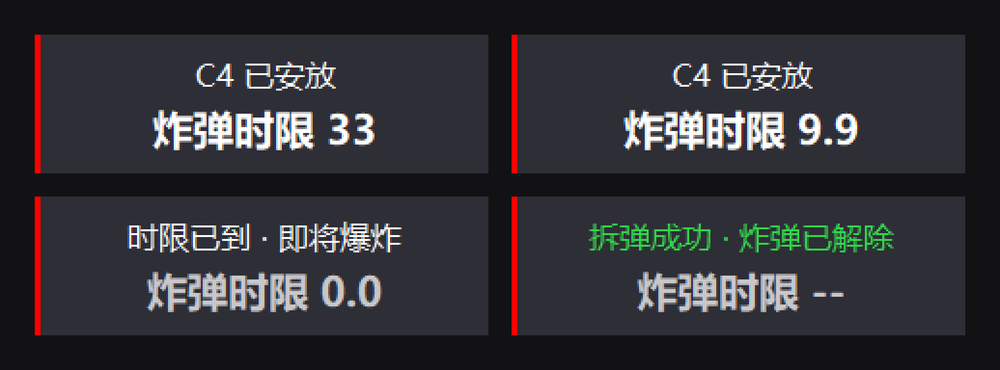

# c4timer —— CS2 炸弹时限倒计时

> **English (short version)**
> A transparent, click-through desktop overlay for **Counter-Strike 2** that shows the **C4 bomb
> timer** — the game's own 40-second defuse deadline — so you can tell at a glance whether you
> still have time to defuse.
> It is **read-only by design**: Valve's official **Game State Integration** plus an optional
> passive loopback recording of your own system audio. No memory reading, no DLL injection,
> no game-file modification, no network tampering, no automated input.
> Windows 10/11 only, Python 3.12. **Free to use and modify; reselling is not allowed** — see
> [LICENSE](LICENSE). Full documentation is in Chinese (this is a Chinese-language project).

在 Windows 桌面上以**透明置顶、鼠标穿透**的悬浮窗显示 C4 的**炸弹时限**

**不读游戏内存、不注入进程、不修改游戏文件、不 hook 任何 API** —— 只用 Valve 官方内置的
GSI 接口，外加（可选的）对自己系统声音的被动录音。详细红线见「安全边界」。

> 📘 **第一次用？先看 [`使用教程+原理.md`](使用教程+原理.md)**（就在根目录，解压后一眼能看到；
> 压缩包里另有一份 `.txt` 副本，双击即可用记事本打开）—— 里面有原理讲解（GSI 是什么、
> 活着时为什么天生有 ±1 秒误差、音频指纹怎么把它校准掉）、安装步骤、九个双击入口的作用、
> 以及"预先要知道的坑"和 FAQ。



*面板的四个状态（由 `tools/shot_hud.py` 画出并截图，不是游戏内实拍）。深灰面板对齐游戏自己那个
"炸弹已被安放"通知框的观感，只显示一个数：**炸弹时限**。*

---

## 项目简介

显示对局中C4爆炸倒计时 便于计算回防时间 拆除炸弹时间是否充足

它同时解决两件事：

1. **活着/死后看队友时**：GSI 的安放事件被 Valve **故意延迟 0.5~2.2 秒**，所以本地时钟
   推算出来的时限天生带秒级误差 —— 程序用**音频指纹**听"安放播报"来修正这个误差
   （实测修正后每一局基本无偏差）。
2. **进了旁观位时**：GSI 直接给服务端倒计时（0.25 秒粒度），程序改用真值显示。


## 功能特性

| 能力 | 说明 |
|---|---|
| 炸弹时限倒计时 | 剩余 >15 秒显示**向上取整**的整数（口径与游戏一致：还剩 39.9 秒时游戏显示 40）；最后 15 秒给一位小数；归零后数字变灰停在 `0.0` |
| 状态行 | 「C4 已安放」/「时限已到 · 即将爆炸」/「拆弹成功 · 炸弹已解除」/「炸弹已爆炸」/「GSI 断连」/「时限未知」 |
| 安放播报指纹识别（可选） | 听游戏自己的"炸弹已被安放"播报，把 T0 校准到真实安放时刻。**两队都启用**（2026-09-19 放开阵营门控），且**必须先被 GSI 揭示包确认**才采用（误报无害：屏幕上什么都不会出现） |
| 旁观位真值 | 一旦进入旁观位（payload 顶层有 `bomb` 块），数字直接来自服务端 `bomb.countdown` |
| GSI 断流兜底 | 时限归零后再等 `explode_after_deadline_sec + local_bang_grace_sec` 自己判"炸了" |
| 位置可调 | 默认屏幕中下方居中、鼠标穿透；用 `run --edit` 拖动定位，松手即存 |
| 单实例保护 | 命名互斥体（不用端口判断 —— 端口是资源不是身份） |
| 自检 | `python -m c4timer test` = **415 项断言**，含真实报文回归、状态机、显示层、端到端、应用层门控、指纹路径 |
| 打包发行 | 可打成**不带源码的 Windows 目录**（PyInstaller onedir），一键组装 + 冒烟校验。见 [`tools/package_release.py`](tools/package_release.py) |

**GSI 到底给什么（本机 600+ 真实报文实测）**：

| 信息 | 活着 / 死后看队友 | **观察者模式**（旁观位） |
|---|---|---|
| 炸弹是否已安放 | ✅ `round.bomb`（**故意迟到 0.5~2.2 秒**） | ✅ `bomb.state`（不迟到） |
| **炸弹时限剩余** | ❌ **GSI 不给** → 本地时钟自走（秒级误差，靠音频修正） | ✅ `bomb.countdown`（0.25s 一更） |
| 炸弹真的炸了 | ✅ `round.phase` → over（约 0.07 秒） | ✅ `bomb.state = "exploded"` |
| 拆弹成功 | ✅ `round.bomb` → defused | ✅ `bomb.state = "defused"` |

> ⚠️ **术语**：第二列说的是**观察者模式**（旁观位，日志里 `obs=1`），**不是**"死了看队友"。
> 死后看队友拿到的信息与活着时一模一样（都没有顶层 `bomb` 块）。

由此定下设计铁律：**观战真值 > GSI 事件 > 本地兜底**。

## 环境依赖

| 项 | 要求 |
|---|---|
| 操作系统 | **Windows 10 / 11**（WASAPI 环回、tkinter 色键透明窗、命名互斥体都是 Win32 API，本程序不支持其它平台） |
| Python | **实测 3.12**（语法下限约 3.9，未在更低版本验证） |
| 必需依赖 | `numpy>=1.24`（音频指纹与频带分析） |
| 可选依赖 | `Pillow>=9`（只有两个截图/样品工具用，产品运行不需要） |
| 游戏 | Counter-Strike 2（官方匹配或 5E / 完美 / B5 均可 —— 本程序不区分平台，只读 GSI） |

## 安装步骤

**最快**：双击 `一键安装.bat` —— 它会依次①找 Python（没有就自动装：先试 winget，失败则从
python.org 下载官方安装器静默安装**当前用户**版，不弹管理员）②装依赖 ③把 GSI 配置装进 CS2
④跑一遍环境体检。装完**重启 CS2** 即可。

想手动一步步来（或在别的机器上排查）：

```bat
:: 1) 装 Python 3.12（安装时勾选 "Add python.exe to PATH"）
::    https://www.python.org/downloads/windows/

:: 2) 装依赖（在仓库目录里执行）
python -m pip install -r requirements.txt

:: 3) 把 GSI 配置装进游戏（双击即可；装完**必须重启 CS2**）
双击 装GSI配置.bat

:: 4) 体检：CS2 目录、cfg 是否装好、端口是否可用、当前生效参数
双击 体检.bat
```

`装GSI配置.bat` 就是把 `gsi/gamestate_integration_csc4.cfg` 复制到
`...\Counter-Strike Global Offensive\game\csgo\cfg\`（等价命令 `python -m c4timer install-gsi`）。

> GSI 配置文件是 **Valve 官方文档化的公开接口**：游戏自己把状态 POST 到本机端口，不是注入、
> 也不是改包。这是本程序**唯一**会写游戏目录的操作，写的就是这一个文件。
> 想更准（把活着时的 ±1 秒压到基本无偏差）还要做一步可选的**音频标定** ——
> 见 [`使用教程+原理.md`](使用教程+原理.md) 的「可选：标定音频」。

## 运行命令

```
双击 一键安装.bat    ← **第一次用推荐**：自动装 Python + 依赖 + GSI 配置 + 体检
双击 装GSI配置.bat  ← 只装 GSI 配置（一键安装里的第 3 步；装完重启 CS2）
双击 体检.bat        ← 环境体检（"怎么没反应"时先跑它）
双击 启动.bat        ← 平时打游戏：GSI + 悬浮窗（启动前会自动补一次音频标定；黑窗口别关，Ctrl+C 退出）
双击 监视GSI.bat     ← 排查 GSI 通不通：逐包打印
双击 演示.bat        ← 不用游戏：把 210 个真实报文回放进悬浮窗
双击 自检.bat        ← 跑全部 415 项断言
双击 录音一局.bat    ← 音频标定第 1 步：录一局（音频 + GSI 对齐）
双击 标定音频.bat    ← 音频标定第 2 步：从落盘片段生成参考指纹 + 看分数
```

等价命令行（`python -m c4timer <子命令>`）：

| 命令 | 作用 |
|---|---|
| `python -m c4timer install-gsi` | 把 GSI 配置装到 CS2 的 cfg 目录（唯一会写游戏目录的操作） |
| `python -m c4timer run` | 正式运行（可加 `--no-hud` / `--edit` / `--debug` / `--seconds N`） |
| `python -m c4timer doctor` | 环境体检 |
| `python -m c4timer listen` | 实时监听 GSI 并逐包打印（`--port`） |
| `python -m c4timer demo` | 回放真实抓包（`--speed` / `--tail` / `--show-idle`） |
| `python -m c4timer test` | 自检（`--file` 指定抓包夹具） |
| `python -m c4timer replay` | 回放抓包并打印时间轴（`--full`） |
| `python -m c4timer config` | 查看/修改配置（`--set KEY=VALUE`） |
| `python -m c4timer calibrate` | 有安放片段又没参考指纹时自动建参考（`启动.bat` 每次启动前跑它） |
| `python -m c4timer set-cs2` | 指定 CS2 游戏目录（自动找不到时的兜底；`--dir` / `--clear`） |

## 使用示例

**看/改配置**

```bat
python -m c4timer config                          :: 打印全部配置（JSON）
python -m c4timer config --set ui.font_size=20           :: 数值行字号（默认 16）
python -m c4timer config --set ui.sub_font_size=14       :: 状态行字号（默认 12）
python -m c4timer config --set ui.scale=1.3              :: 整体缩放
python -m c4timer config --set ui.show_idle=true         :: 待机时也常驻（方便确认程序在跑）
python -m c4timer config --set gsi.stale_after_sec=15    :: 多久没包算断连（必须 > 心跳 10 秒）
python -m c4timer config --set timers.plant_latency_compensation=0.8   :: 安放通知延迟补偿
python -m c4timer config --set audio.onset_bias_sec=0.6  :: 音频时间偏置（>0 = 归零更晚）
```

**挪悬浮窗位置**

```bat
python -m c4timer run --edit     :: 编辑模式：窗口不再穿透，拖到位松手即保存
```

**标定音频指纹（可选，用自己机器的声音）**

```bat
双击 录音一局.bat                :: 录一局（音频 + GSI 同步）
python tools\build_fingerprints.py   :: 从程序自动落盘的 10 秒安放片段生成参考指纹
python tools\fp_eval.py              :: 离线看真身/误报的分数分布
python tools\fp_eval.py --detector 某个片段.wav   :: 直接跑产品链路，看会不会命中
```

> ⚠️ 改 `gsi.stale_after_sec` 别往小改（心跳 10 秒，设 5 会在正常游玩时反复误报断连）；
> `config --set` 会把**全部字段**写盘（等于把当时的默认值钉死），改完用 `体检.bat` 看一行
> 「生效参数来源」。

## 项目结构说明

```
C4time/
├─ README.md                 本文件：简介/特性/依赖/安装/运行/示例/结构
├─ requirements.txt          依赖声明（numpy 必需；Pillow 可选，见文件内注释）
├─ .gitignore                忽略运行产物（runtime/、sessions/、config.json、dist/、__pycache__）
│
├─ 一键安装.bat              双击入口：自动装 Python + 依赖 + GSI 配置 + 体检（推荐第一次用）
├─ 装GSI配置.bat             双击入口：把 GSI 配置装进 CS2   -> python -m c4timer install-gsi
├─ 体检.bat                  双击入口：环境体检        -> python -m c4timer doctor
├─ 启动.bat                  双击入口：正式运行        -> python -m c4timer run
├─ 监视GSI.bat               双击入口：只监听 GSI      -> python -m c4timer listen
├─ 演示.bat                  双击入口：无游戏回放      -> python -m c4timer demo
├─ 自检.bat                  双击入口：跑自检          -> python -m c4timer test
├─ 录音一局.bat              双击入口：录音标定        -> python tools/record_audio.py
├─ 标定音频.bat              双击入口：生成参考指纹 + 看分数 -> python tools/build_fingerprints.py
│
├─ c4timer/                  **产品代码**（只含运行时代码，不含测试）
│  ├─ __init__.py            包说明 + __version__
│  ├─ __main__.py            CLI 入口：test/replay/listen/run/doctor/demo/config/calibrate
│  ├─ app.py                 主循环接线：GSI 线程 + 状态机 + 音频检测 + 悬浮窗 + 落盘
│  ├─ state.py               状态机（纯逻辑，可单测）：T0 锚点、补偿、标定、终局判定
│  ├─ render.py              显示规则（Snapshot -> 行/颜色/文案），纯逻辑
│  ├─ hud.py                 tkinter 透明置顶点击穿透悬浮窗（Win32 色键、DPI、拖动）
│  ├─ gsi.py                 GSI HTTP 接收 + payload 解析（五条实测铁律写在注释里）
│  ├─ config.py              配置 dataclass（Gsi/Timers/Audio/Ui/Debug）+ JSON 读写
│  ├─ paths.py               全项目唯一解析数据目录的地方（打包后要落到 exe 旁边）
│  ├─ buildrefs.py           从落盘片段生成参考指纹（原 tools/build_fingerprints.py）
│  ├─ autocal.py             自动标定策略：有素材、没参考时才建（原 tools/auto_calibrate.py）
│  ├─ cs2path.py             只读定位 CS2 目录、体检 GSI cfg
│  ├─ fixtures.py            抓包夹具加载器（回归基线用）
│  ├─ logs.py                滚动日志（写 runtime/c4timer.log）
│  ├─ single.py              单实例保护（命名互斥体）
│  └─ audio/                 **音频子系统**
│     ├─ __init__.py         模块地图 + 全链路唯一的 ANALYSIS_RATE
│     ├─ capture.py          采集线程封装（产品用它）
│     ├─ loopback.py         WASAPI 回环采集（系统混音 / 进程两种模式）
│     ├─ combase.py          WASAPI/COM 的 ctypes 绑定
│     ├─ plant.py            安放播报检测器：分块喂入 -> 命中时刻
│     ├─ fingerprint.py      音频指纹：时频峰值星座 + 成对哈希 + 时间偏移分箱
│     ├─ detect.py           频带特征（旧路径仍提供 band_features）
│     ├─ events.py           纯数据类型
│     └─ wav_io.py           WAV 读写 + 重采样
│
├─ tests/                    **自检套件**（不属于产品包，发布时不需要）
│  ├─ __init__.py            五个模块各覆盖什么 + 跑法
│  ├─ checks.py              共享断言计数器（ok/eq/ge/near）
│  ├─ test_gsi.py            P0：210 个真实 GSI 报文的解析回归
│  ├─ test_state.py          P1：状态机全部规则
│  ├─ test_render.py         P1：显示层（文案/颜色/尺寸）
│  ├─ test_e2e.py            P3：真实报文走完整链路
│  ├─ test_app.py            P3：应用层门控与接线（含音频指纹路径）
│
├─ tools/                    工具脚本（不属于产品运行链路）
│  ├─ record_audio.py        标定用：WASAPI 环回 + GSI 同步采集（录音一局.bat 调它）
│  ├─ build_fingerprints.py  （壳）生成参考指纹 -> c4timer/buildrefs.py
│  ├─ auto_calibrate.py      （壳）启动时自动标定 -> c4timer/autocal.py
│  ├─ package_release.py     打包发行：编译 + 组装 + 收集第三方许可 + 发行包校验
│  ├─ smoke_release.py       打包后冒烟测试（真 exe 验冻结路径与数据目录）
│  ├─ make_release_zip.py    打源码压缩包：--lite 精简版（给使用者）/ 默认整包
│  ├─ fp_eval.py             离线评测指纹：真身/误报分数分布；--detector 跑产品链路
│  ├─ audio_calibrate.py     旧路径的模板标定（频带能量那代，保留备查）
│  ├─ check_smoothness.py    量悬浮窗读秒的间隔抖动
│  ├─ shot_hud.py            九个状态的悬浮窗截图（样式回归用）
│  └─ mock_panel.py          面板样式样品（一次性，把面板画在游戏截图上）
│
├─ packaging/                **发行侧素材**（打包时被 tools/package_release.py 取用）
│  ├─ launcher.py            打包入口（不带参数等价于 run）
│  ├─ 启动.bat               发行版启动器（自动标定 + 启动 + 出错时停窗）
│  ├─ 装GSI配置.bat          发行版：装 CS2 的 GSI 配置
│  ├─ 体检.bat               发行版：环境自检
│  ├─ 打包带走.bat           整包压成一个 zip，方便带去网吧
│  ├─ 指定游戏目录.bat       自动找不到游戏时的兜底（把文件夹拖进去即可）
│  ├─ 使用说明.txt           给使用者的说明（含网吧流程）
│  ├─ 用户协议.txt           使用条款
│  └─ licenses/zlib.txt      本机环境里没有、手抄一份存好的第三方许可
│
├─ gsi/
│  └─ gamestate_integration_csc4.cfg   要装进 CS2 的 GSI 配置模板（官方格式，由装GSI配置.bat 复制）
├─ fixtures/
│  └─ gsi_capture_20260915.jsonl   冻结的回归基线：210 个真实 GSI 报文
├─ docs/
│  ├─ README.md              文档索引 + 验证命令
│  ├─ img/hud.png            README 首图（tools/shot_hud.py 生成，不是游戏内实拍）
│  ├─ 自成长设计.md           参考成长 + 时间自成长的门槛、限幅与数据文件
│  ├─ HUD界面说明.md         悬浮窗视觉规格与硬约束（交接文档）
│  ├─ 精度方案总览.md        精度方案清单：现状、候选方案、风险与安全类别
│  └─ 实机反馈与待办.md      实测流水账与决策记录（含"为什么不那样做"）
│
├─ runtime/                  **运行产物（不进版本库）**：日志、落盘音频、参考指纹
└─ sessions/                 **历史录音会话（不进版本库）**：音频 + GSI 存档
```

## 自检

```bat
python -m c4timer test
```

**415 项断言**，分五组：

| 组 | 条数 | 内容 |
|---|---|---|
| P0 GSI 解析 | 42 | 用 210 个真实报文回归（终局残留、倒计时语义切换、`team=`/`chg=` 解析） |
| P1 状态机 | 130 | 全部转移规则；40 秒内回合结束必须重置；最后一秒拆弹成功不被本地兜底抢先；`CALIB` 误差区间；迟到 `planted` 不许复活终局；锚点与间隔上界夹取；`feed_audio_plant` 的 T0 修正窗口 |
| P1 显示层 | 64 | 标签、15 秒整数/小数阶梯（整数档向上取整）、各状态文案、GSI 断连提示、面板尺寸不随数字抽动 |
| P3 端到端 | 27 | 真实报文走完整链路：迁移合法性、显示与状态一致、T0 始终可信 |
| P3 应用层 | 152 | `CALIB` 区间、启动横幅、HUD 只在内容变化时重排、单实例、cfg 体检、配置读写、日志只读兜底、**音频指纹路径**（合成播报必须命中、纯噪声不报、`stream_time` 正确） |

打包出来的 exe 另有一道**冒烟测试**（`python tools/smoke_release.py`），
8 项全过才算能用 —— 它验的是自检覆盖不到的那一半：真 exe 下的冻结数据目录与日志落盘。


## 安全边界（这个项目**不做**什么）

用户只打**官匹和平台**（5E / 完美 / B5），也明确要求"不能有任何被封禁或被判定为作弊的风险"。
所以红线是：**只读、被动、不碰游戏**。任何新功能都必须落在这条线内。

**会做的（全部是被动观察，与被禁止的做法在原理上没有交集）**

- 在游戏目录放一个 **Valve 官方文档化的 GSI 配置**（`gamestate_integration_*.cfg`）——
  游戏自己把状态 POST 到本机端口。这是 Valve 给直播/工具用的公开接口。
- 在本机 `127.0.0.1:30077` 收这些 HTTP 包；画一个**普通的** Windows 悬浮窗（置顶 + 鼠标穿透）。
- 精度增强：录**自己的系统声音**、截**自己的屏幕** —— 与 OBS 同类的被动采集。

**明确不做（有封禁/判定风险，永不实现）**

- ❌ 读游戏内存、注入 DLL、hook 游戏函数、改游戏文件（官方 GSI cfg 除外）。
- ❌ 修改或伪造网络流量、抓包解析游戏协议。
- ❌ **服务端插件**（Metamod / SourceMod / CounterStrikeSharp）—— 官匹和平台根本不给装，
  且那属于改服务器。同类项目 [R0mz1k/css-C4-Timer](https://github.com/R0mz1k/css-C4-Timer)、
  [Axiol1te/CS2-C4Timer](https://github.com/Axiol1te/CS2-C4Timer) 都是这一类：它们准，
  是因为跑在服务器上能直接读 `bomb_planted` 事件和 `planted_c4` 实体。
- ❌ 任何模拟输入 / 自动操作。

**如实说明**：任何第三方工具都拿不到平台的"官方保证"。这里能做的是让实现停在**原理上最安全的一档**
—— 只读、不注入、不访问游戏进程 —— 和作弊工具（改内存、注入、改包）在原理上完全不同。

## 已知边界

0. 拆弹的最后时限（不是真正的爆炸瞬间）。它对齐游戏自己那个 40 秒计时器归零的
   时刻，实测**真爆比它晚约 1.05 秒**，所以红字归零后还会再等约 1 秒才炸 —— 这正是"赶不赶得上"
   的判断依据。
1. **活着/死后看队友时的时限天生有秒级误差，而且这是 Valve 故意做的**。2015-12-17 官方补丁说明：
   > "Bomb plant timer Game State Integration event is now **slightly delayed** when playing on
   > Terrorist or Counter-Terrorist team." —— <https://blog.counter-strike.net/2015/12/13409/>

   实测：从"游戏计时器起点"到"GSI 第一次报 `round.bomb=planted`"延迟 **0.5~2.2 秒**，
   而爆炸通知只要 **0.07 秒** ⇒ 慢的不是 HTTP，是游戏内部**只堵了"安放"这一个信号**。
   本程序用两条路压缩这个误差：**锚点**（认出"安放触发的那一包" ⇒ 真实安放 ≈ 它 − 0.10 秒）
   与**音频指纹**（听播报）⇒ 实测修正后每一局基本无偏差。
2. **音频指纹的边界**：指纹要"听完一整句"才够分，所以检测天然滞后 1.8~3.7 秒，常晚于 GSI
   揭示包（这一点已专门修过：迟到的候选也当场确认）；被枪声完全盖住的局会漏检（漏了就退回
   GSI 估计，不会算得更差）；参考指纹必须用**自己机器、自己语音包**的录音标定
   （游戏音频不进版本库）。阈值见「已知边界」下的说明与 `docs/实机反馈与待办.md` 23.12~23.20。
3. **中途启动 / 重连**：程序开始跑时炸弹**已经**安放了 ⇒ 界面显示「时限未知」，
   而不是给一个会被信的错数字（进旁观位拿到服务端倒计时后恢复正常）。
4. **绝不能拿 `player.state.health == 0` 判断自己死了** —— 观察者位或死后看队友时，`player`
   块描述的是被看的那个人。判据是 payload 顶层有没有 `"bomb"` 键。
5. **`defusing` 期间不把 `bomb.countdown` 当炸弹时限** —— 实测那一刻它会从"到爆炸剩余"跳成
   "到拆弹成功剩余"（21.6 → 9.8）。所以 `defusing` 只被当作"红字照常走"的信号。

## 常见问题（FAQ）

**面板不出现？**
默认只在炸弹安放后才出现、结束文案停留 1.5 秒后消失。想常驻：`config --set ui.show_idle=true`。

“全屏”模式下显示不出 建议使用“全屏窗口模式”

**显示「时限未知」？**
程序启动时炸弹已经安放了（见「已知边界」第 3 条）。下一回合会恢复正常。

**显示「GSI 断连」？**
先跑 `体检.bat`：多数是 GSI cfg 没装/端口不一致，或另有程序占着 30077。也可能是
`gsi.stale_after_sec` 被设得比心跳（10 秒）还小。

**音频没生效（日志里没有"播报候选"）？**
按顺序查三件事：① 参考指纹有没有（`runtime/audio_templates/*.npz` 存在吗？没有就
`录音一局.bat` + `tools/build_fingerprints.py` 标定）；② 回合在不在 live（主菜单/买枪阶段不算）；
③ 日志里 `音频电平` 那行的 RMS 是否为 0（是 0 说明采集没拿到声音 ⇒ 系统音量/输出设备问题）。

**归零偏早或偏晚？**
音频生效时，整体偏早/偏晚调 `audio.onset_bias_sec`（+0.1 = 归零晚 0.1 秒）。
音频没生效时（锚点路径）调 `timers.plant_latency_compensation`（越大归零越早）。

**能用在 5E / 完美 / B5 吗？**
能。本程序只读 GSI，与平台无关。

## 文档索引

| 文档 | 看它解决什么问题 |
|---|---|
| [`使用教程+原理.md`](使用教程+原理.md) | **第一次用**：原理（GSI/为什么天生有误差/音频指纹）、三步安装、九个入口、坑与 FAQ |
| [`docs/README.md`](docs/README.md) | 文档索引 + 三条验证命令 |
| [`docs/HUD界面说明.md`](docs/HUD界面说明.md) | 面板的视觉规格与硬约束（改 UI 前先读） |
| [`docs/自成长设计.md`](docs/自成长设计.md) | 参考指纹与时间补偿怎么"越打越准"、门槛与限幅 |
| [`docs/精度方案总览.md`](docs/精度方案总览.md) | 精度从哪来、还有哪些候选方案、各自的安全类别 |
| [`docs/实机反馈与待办.md`](docs/实机反馈与待办.md) | **实测流水账与决策记录**：每次实测数据、每次拍板与理由、走过的弯路、以及"为什么不那样做" |

## 许可证

源码公开，**免费使用**。许可证是 **MIT + Commons Clause**，全文见 [LICENSE](LICENSE)。

仓库里从不包含游戏音频（播报录音、参考指纹）—— 那是 Valve 的素材，
而且与本机声卡、语音包相关，换机器本来也不该照搬：
新机器上由程序自己"打一局 → 自动建参考"重新长出来。

发行包里**第三方组件**的许可与版权声明由打包脚本自动收集，放在产物的
`第三方许可/` 目录下；本机环境里取不到的（zlib 等）在 `packaging/licenses/` 里
手工存放一份。哪些内嵌了、哪些还没内嵌，那份 README 会逐条列出来。

##免责与使用声明
✅ 允许：
个人免费使用、自行修改源码、非商业转载和分享（转载时请保留本声明原文，注明原作者）

❌ 禁止：
未经作者书面许可，将本项目、编译程序、衍生修改版本用于任何商业行为，包括但不限于售卖、付费打包、付费定制、直播带货、收费资源等盈利场景。

📌 对局使用提示：
本项目仅建议用作技术学习、Demo 演示。**不建议在游戏正式对局内使用**。
如使用者无视本提示，在游戏对局（匹配/排位/赛事等）中使用本程序，由此引发的一切后果（包括账号封禁、处罚等），均由使用者自行承担，本作者不承担任何责任。
